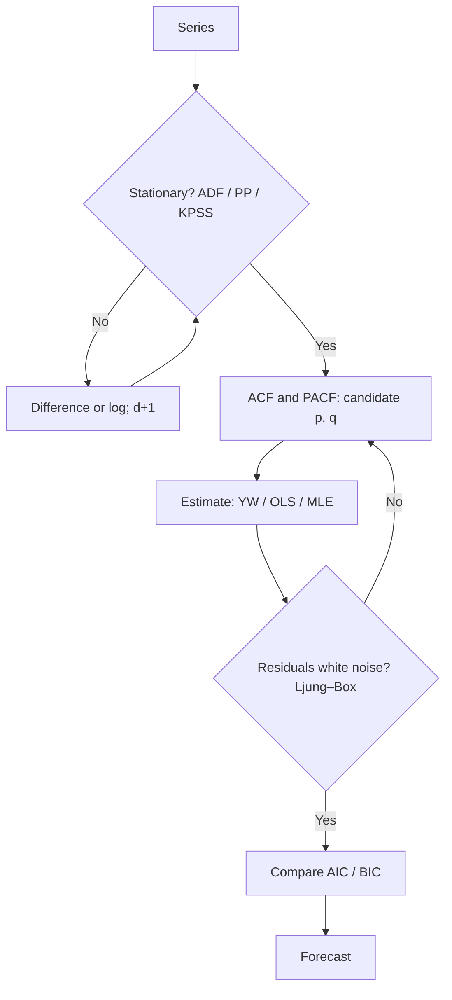

# ACF, PACF and the Box–Jenkins Methodology

[[04 - AR, MA and ARMA Processes]] went from model to ACF; this chapter goes from data to model. The tools: the ACF and PACF, unit-root tests for stationarity, and AIC/BIC to choose among candidates.

## 📘 Main Knowledge

### ACF and PACF

**ACF**: $\rho(k)=\gamma(k)/\gamma(0)$, the total linear dependence at lag $k$, including indirect effects through intermediate lags. Slow decay signals strong dynamics.

**PACF**: $\rho_{kk}=\operatorname{Corr}(Y_t,Y_{t-k}\mid Y_{t-1},\dots,Y_{t-k+1})$, the direct dependence after removing intermediate lags.

| Process | ACF | PACF |
|---|---|---|
| AR(p) | tails off | cuts off after $p$ |
| MA(q) | cuts off after $q$ | tails off |
| ARMA(p,q) | tails off | tails off |

An AR(p) has finite direct memory but infinite total memory; an MA(q) the reverse. The PACF asks "is there a direct link?", the ACF "is there any path?".

### Estimating the ACF

$$\hat\gamma_k=\frac1n\sum_{t=k+1}^n(Y_t-\bar Y)(Y_{t-k}-\bar Y),\qquad\hat\rho(k)=\frac{\hat\gamma_k}{\hat\gamma_0}.$$
Dividing by $n$ (not $n-k$) is slightly biased but keeps the autocovariance matrix positive semi-definite; standard software does this. Sample ACFs are never exactly zero, and estimates at long lags rest on few pairs: inspect at most about $n/4$ lags.

### Estimating the PACF

1. **OLS**: regress $Y_t$ on $Y_{t-1},\dots,Y_{t-k}$; $\rho_{kk}=a_{kk}$, the coefficient on the last lag. One regression per $k$.
2. **Yule–Walker**: solve $\mathbf P_k\mathbf a_k=\boldsymbol\rho_k$ with the Toeplitz matrix $\mathbf P_k$ of $1,\rho_1,\dots,\rho_{k-1}$; $\rho_{kk}$ is the last element.
3. **Durbin–Levinson** (fast, $O(k)$ per step): $\rho_{11}=\rho_1$;
$$\rho_{kk}=\frac{\rho_k-\sum_{j=1}^{k-1}\rho_{k-1,j}\rho_{k-j}}{1-\sum_{j=1}^{k-1}\rho_{k-1,j}\rho_j},\qquad\rho_{kj}=\rho_{k-1,j}-\rho_{kk}\rho_{k-1,k-j}.$$
At lag 2, $\rho_{22}=\frac{\rho_2-\rho_1^2}{1-\rho_1^2}$: the lag-2 correlation minus what passes through lag 1. For an AR(1), $\rho_2=\rho_1^2$, so $\rho_{22}=0$. At lag 3, $\rho_{33}=\frac{\rho_3-(\rho_{21}\rho_2+\rho_{22}\rho_1)}{1-(\rho_{21}\rho_1+\rho_{22}\rho_2)}$ with $\rho_{21}=\rho_{11}(1-\rho_{22})$.

Under $H_0:\rho_{kk}=0$, $\operatorname{Var}(\hat\rho_{kk})\approx1/n$, giving the ±2/√n bands on PACF plots. For a true AR(p), $\rho_{pp}=\phi_p$.

**Lecture example: Vietnam monthly CPI, 1995M01–2007M12** ($n=156$), $\hat\rho_1=0.338$, $\hat\rho_2=0.082$, $\hat\rho_3=0.104$:
- $\hat\rho_{11}=0.338$;
- $\hat\rho_{22}=(0.082-0.1142)/0.8858=-0.036$ (lag 1 alone over-predicts the lag-2 correlation);
- $\hat\rho_{21}=0.338(1+0.036)=0.350$;
- $\hat\rho_{33}=\frac{0.104-(0.350\cdot0.082-0.036\cdot0.338)}{1-(0.350\cdot0.338-0.036\cdot0.082)}=0.099$.

The band is ±2/√156 = ±0.160, so only lag 1 is significant. The lecture concludes that CPI is not a simple AR(p) and needs a seasonal model (annual cycle at lags 12, 24, …; [[07 - SARIMA and Vector Autoregression]]).

### Significance of autocorrelations

**One lag (Bartlett)**: under $H_0:\rho_k=0$ for a white-noise series, $\hat\rho_k\sim N(0,1/n)$; reject if $|\hat\rho_k|>1.96/\sqrt n$ (the ±2/√n band). When lags up to $m$ are non-zero, $\operatorname{Var}(\hat\rho_k)\approx\frac1n\big(1+2\sum_{i=1}^m\rho_i^2\big)$ for $k>m$ (statsmodels' default `bartlett_confint`).

**Joint tests** of $H_0:\rho_1=\dots=\rho_m=0$ (testing 20 lags one at a time gives about one false rejection at 5%):
$$\text{Box–Pierce: }Q=n\sum_{k=1}^m\hat\rho_k^2,\qquad\text{Ljung–Box: }Q^*=n(n+2)\sum_{k=1}^m\frac{\hat\rho_k^2}{n-k}\sim\chi^2(m).$$
Ljung–Box is used twice: on the raw series (you hope to reject: there is structure to model) and on residuals of a fitted model (you hope not to reject). For residuals of an ARMA(p,q), use $\chi^2(m-p-q)$; in statsmodels set `model_df`.

### Unit-root tests

Stationarity matters because ARIMA assumes it, and non-stationary series give spurious regressions, invalid inference and unstable forecasts.

**Dickey–Fuller**: from $Y_t=\phi Y_{t-1}+\varepsilon_t$, subtract $Y_{t-1}$: $\Delta Y_t=\delta Y_{t-1}+\varepsilon_t$ with $\delta=\phi-1$. $H_0:\delta=0$ (unit root) vs $H_1:\delta<0$ (stationary), statistic $\tau=\hat\delta/\mathrm{se}(\hat\delta)$. Under $H_0$, τ follows the **Dickey–Fuller distribution**, not Student's t (5% critical value about −2.86 with a constant, not −1.96); t-tables reject far too often. Three variants, each with its own critical values: no constant; constant; constant and trend. Wrongly including a trend costs power; omitting a needed one biases towards non-rejection.

**Augmented DF** adds lagged differences to absorb autocorrelated errors:
$$\Delta Y_t=\beta_1+\beta_2t+\delta Y_{t-1}+\sum_{k=1}^q\theta_k\Delta Y_{t-k}+\varepsilon_t.$$
The lagged terms are nuisance parameters; choose $q$ by AIC/BIC or e.g. $\lfloor12(n/100)^{1/4}\rfloor$. More negative than the critical value ($p<0.05$): stationary (trend-stationary with a trend term); otherwise: unit root, difference.

**Phillips–Perron** corrects the DF statistic non-parametrically for autocorrelation and heteroskedasticity:
$$\tilde t=t_\delta\Big(\frac{\gamma_0}{f_0}\Big)^{1/2}-\frac{n(f_0-\gamma_0)\,\mathrm{se}(\hat\delta)}{2f_0\hat\sigma},$$
with $f_0$ the long-run residual variance (Newey–West kernel); with no serial correlation $f_0=\gamma_0$ and it reduces to DF.

**KPSS** reverses the null. $Y_t=\delta'X_t+\varepsilon_t$ with $X_t=1$ (level) or $[1,t]$ (trend); $H_0$: stationary, $H_1$: random walk.
$$LM=\frac1{nf_0}\sum_tS(t)^2,\qquad S(t)=\sum_{r\le t}e_r$$
(partial sums of OLS residuals stay moderate if stationary, explode under a unit root). $p<0.05$: non-stationary.

| Test | $H_0$ | Approach | Rejecting means |
|---|---|---|---|
| ADF | unit root | adds lagged differences | stationary |
| PP | unit root | non-parametric correction | stationary |
| KPSS | stationary | tests for a random-walk component | non-stationary |

Use them together:

| ADF/PP | KPSS | Conclusion |
|---|---|---|
| don't reject | reject | unit root: difference |
| reject | don't reject | stationary |
| don't reject | don't reject | inconclusive (short data) |
| reject | reject | conflict: breaks? fractional integration? |

All have low power against near-unit roots (φ = 0.95 vs 1 with ~200 observations).

### ARIMA

$Y_t$ is $I(d)$ if its $d$-th difference is stationary ($I(0)$: already stationary). An ARMA(p,q) on the $d$-th difference is **ARIMA(p,d,q)**: $\phi(L)(1-L)^dY_t=\phi_0+\theta(L)\varepsilon_t$. "Integrated": the series is a running sum of a stationary ARMA. Economic data rarely need $d>2$; don't over-difference (negative lag-1 spike); take logs first if the variance grows with the level ($\Delta\log Y$ is a growth rate).

### Box–Jenkins

Three steps, iterated until the model is adequate:
1. **Identification**: $d$ from unit-root tests, then $p$ and $q$ from the ACF/PACF of the stationary series.
2. **Estimation** of the parameters.
3. **Diagnostics**: residuals should be white noise (Ljung–Box); compare candidates by AIC/BIC.

| ARIMA | ACF (of the differenced series) | PACF |
|---|---|---|
| (p,d,0) | exponential/sinusoidal decay | zero after lag $p$ |
| (0,d,q) | zero after lag $q$ | exponential/sinusoidal decay |
| (1,d,1) | $\rho_1\ne0$, then decay | $\rho_{11}\ne0$, then decay |
| (1,d,2) | $\rho_1,\rho_2\ne0$, then decay | $\rho_{11}\ne0$, then decay |
| (2,d,1) | $\rho_1\ne0$, then decay | $\rho_{11},\rho_{22}\ne0$, then decay |
| (2,d,2) | $\rho_1,\rho_2\ne0$, then decay | $\rho_{11},\rho_{22}\ne0$, then decay |

"Cuts off" means inside the band from that lag on. The lecture stresses there are no rules for perfectly accurate results: the table gives a shortlist, decided by diagnostics and information criteria.

**Information criteria** (lower is better; $k$ counts all parameters):
$$AIC=-2\ln L+2k=n\ln\hat\sigma^2+2k,\qquad BIC=-2\ln L+k\ln n=n\ln\hat\sigma^2+k\ln n.$$
For $n>7$, $\ln n>2$, so BIC penalizes more and picks smaller models. AIC aims at prediction (efficient but not consistent); BIC at the true order (consistent). Compare only models fitted to the same data: choose $d$ by tests, then $p,q$ by criteria.

**Estimation**
- **Yule–Walker**: linear, AR only ($\hat\rho_k=\sum_i\hat\phi_i\hat\rho_{k-i}$); used for starting values.
- **OLS**: linear for pure AR; with MA terms the lagged shocks depend on the parameters, so the problem is non-linear.
- **Method of moments**, e.g. ARMA(1,1): $\gamma(0)=\phi\gamma(1)+\sigma^2(1+\theta^2+2\phi\theta)$, $\gamma(1)=\phi\gamma(0)+\sigma^2\theta$; a non-linear system, inefficient.
- **Maximum likelihood** (default): with normal errors, compute $\varepsilon_t=Y_t-\phi_0-\sum\phi_iY_{t-i}-\sum\theta_j\varepsilon_{t-j}$ recursively; $\ln L=-\frac n2\ln2\pi-\frac n2\ln\sigma^2-\frac1{2\sigma^2}\sum e_t^2$, so maximizing it means minimizing $\sum e_t^2$, with $\hat\sigma^2=\frac1n\sum e_t^2$. Optimizers: Newton–Raphson, Fisher scoring, BFGS, Nelder–Mead, EM; start from YW/OLS/CSS. Conditional MLE sets pre-sample shocks to 0; exact MLE uses the Kalman filter (statsmodels' default; [[06 - The Kalman Filter and State-Space Models]]). The likelihood is flat near the stationarity/invertibility boundary.

## ✏️ Exercises

**1.** With $n=200$ (band ±0.141), identify:

| | lag 1 | 2 | 3 | 4 | 5 | 6 |
|---|---|---|---|---|---|---|
| (a) ACF | 0.72 | 0.51 | 0.37 | 0.26 | 0.19 | 0.13 |
| (a) PACF | 0.72 | −0.03 | 0.05 | −0.02 | 0.04 | −0.01 |
| (b) ACF | 0.45 | −0.09 | 0.06 | −0.02 | 0.03 | 0.01 |
| (b) PACF | 0.45 | −0.36 | 0.28 | −0.20 | 0.15 | −0.10 |
| (c) ACF | 0.98 | 0.96 | 0.94 | 0.92 | 0.90 | 0.88 |
| (c) PACF | 0.98 | −0.02 | 0.01 | 0.03 | −0.01 | 0.02 |

> [!example]- Solution
> (a) AR(1), φ ≈ 0.72: PACF cuts off, ACF ≈ $0.72^k$ (0.518, 0.373).
> (b) MA(1): ACF cuts off, PACF alternates. $\theta/(1+\theta^2)=0.45$ gives θ = 1.595 or 0.627 (reciprocals); the invertible one is 0.63.
> (c) A unit root: ACF near 1 and decaying linearly. Don't fit AR(1) with φ = 0.98; test, difference and re-plot. (a) and (c) both have a single PACF spike; the ACF's decay shape tells them apart, so test stationarity first.

**2.** $\rho_1=0.6$, $\rho_2=0.5$, $\rho_3=0.3$. Compute the PACF to lag 3 and suggest a model.

> [!example]- Solution
> $\rho_{11}=0.6$; $\rho_{22}=(0.5-0.36)/0.64=0.21875$; $\rho_{21}=0.6(0.78125)=0.46875$; $\rho_{33}=\frac{0.3-(0.234375+0.13125)}{1-(0.28125+0.109375)}=\frac{-0.065625}{0.609375}=-0.1077$. With $n=100$ (band ±0.20): AR(2).
> Yule–Walker for AR(2) gives $\phi_2=0.21875=\rho_{22}$ and $\phi_1=0.46875=\rho_{21}$. The implied $\rho_3=0.3656$ exceeds the observed 0.3, hence the small negative $\rho_{33}$. Stationary ($\phi_1+\phi_2=0.6875<1$, $\phi_2-\phi_1<1$, $|\phi_2|<1$); $\phi_1^2+4\phi_2=1.095>0$, real roots.

**3.** An ARIMA(1,1,1) fitted to $n=120$ observations has residual autocorrelations 0.05, −0.12, 0.08, 0.21, −0.03. (a) Test each lag. (b) Ljung–Box with $m=5$. (c) Conclusion?

> [!example]- Solution
> (a) Band ±0.183: only lag 4 (0.21) is outside.
> (b) $Q^*=120\cdot122\cdot\sum\hat r_k^2/(120-k)=14640\times0.0005857=8.575$. With $df=m-p-q=3$: critical value 7.815, reject ($p=0.036$). With the naive 5 df (11.07) you would wrongly accept the model.
> (c) Residuals aren't white noise, pointing at lag 4: with quarterly data, seasonality, so try e.g. $(1,1,1)(0,1,1)_4$ ([[07 - SARIMA and Vector Autoregression]]); otherwise enrich the ARMA part. Compare by AIC only among models that pass Ljung–Box.

**4.** Quarterly log real GDP of Vietnam, 2000Q1–2023Q4 (n = 96; illustrative numbers):

| Test | Specification | Statistic | p |
|---|---|---|---|
| ADF, levels | constant + trend | −2.31 | 0.42 |
| KPSS, levels | trend | 0.19 | < 0.05 |
| ADF, Δlog | constant | −4.87 | < 0.01 |
| KPSS, Δlog | level | 0.11 | > 0.10 |

(a) Integration order? (b) Why both tests? (c) Model family? (d) What to check first?

> [!example]- Solution
> (a) Levels: ADF doesn't reject a unit root and KPSS rejects stationarity: non-stationary. Differences: both say stationary. So log GDP is I(1), and Δlog GDP is the quarterly growth rate.
> (b) ADF has low power, so non-rejection is weak evidence; KPSS's rejection is positive evidence. Agreement across opposite nulls is much stronger.
> (c) ARIMA(p,1,q) on log GDP (ARMA on growth).
> (d) Seasonality (spikes at lags 4, 8, 12 → SARIMA; unit-root tests on seasonal data are unreliable); structural breaks (COVID-19 in 2020 biases ADF towards non-rejection; Zivot–Andrews or dummies); whether the trend term is significant; ADF lag length and residuals.

**5.** Four ARIMA models on the same 150 differenced observations:

| Model | $k$ | $\ln L$ |
|---|---|---|
| (1,1,0) | 3 | −210.4 |
| (2,1,0) | 4 | −206.1 |
| (1,1,1) | 4 | −205.8 |
| (2,1,2) | 6 | −203.9 |

Compute AIC and BIC; which model?

> [!example]- Solution
> $\ln150=5.011$.
>
> | Model | AIC | BIC |
> |---|---|---|
> | (1,1,0) | 426.8 | 435.83 |
> | (2,1,0) | 420.2 | 432.24 |
> | (1,1,1) | **419.6** | **431.64** |
> | (2,1,2) | 419.8 | 437.86 |
>
> Both choose ARIMA(1,1,1). (2,1,2)'s two extra parameters gain 3.8 in $-2\ln L$: AIC charges 4 (a near tie; differences under ~2 mean little), BIC charges 10 (worst). Before finalizing: Ljung–Box on residuals, parameter significance, roots outside the unit circle, and out-of-sample RMSE on a hold-out if forecasting. If they disagreed: AIC for forecasting, BIC for structure, otherwise the simpler model.

## 📝 Summary

- ACF: total dependence; PACF: direct dependence (OLS, Yule–Walker, Durbin–Levinson).
- AR: PACF cuts off; MA: ACF cuts off; ARMA: neither; random walk: ACF near 1, linear decay.
- $\rho_{22}=(\rho_2-\rho_1^2)/(1-\rho_1^2)$; for AR(p), $\rho_{pp}=\phi_p$.
- Bands ±2/√n; Ljung–Box jointly, with $m-p-q$ df on residuals.
- ADF ($H_0$ unit root, Dickey–Fuller critical values), PP (non-parametric), KPSS ($H_0$ stationary); combine them.
- ARIMA(p,d,q): ARMA on the $d$-th difference; choose $d$ by tests.
- Box–Jenkins loop: identify → estimate → diagnose.
- AIC for forecasting, BIC for parsimony; only residual checks certify adequacy.
- MLE is the default estimator.

## ⚠️ Important Notes

1. Test stationarity before reading ACF/PACF: a random walk mimics AR(1) in the PACF.
2. "Cuts off" means inside the band; with $n=100$ the band is ±0.20, so small effects vanish.
3. Use $\chi^2(m-p-q)$ for residual Ljung–Box (`model_df` in statsmodels).
4. Don't compare AIC across different $d$.
5. Quadrupling $n$ halves the band.
6. A negative lag-1 spike after differencing means over-differencing.
7. A spike at the seasonal lag (4, 12) means SARIMA.
8. DF statistics are not t-distributed.
9. Auto-ARIMA tools don't replace residual checks.

> [!warning] Gaps in the source slides
> - The data files (`CPI_PACF.xlsx`, `gdp_Pacf.xlsx`) are Colab paths not in the vault; the CPI PACF was checked from the quoted autocorrelations (−0.036 and 0.350 at full precision), and the GDP example (cells s11–s17) can't be reproduced.
> - Bartlett's formula is printed as $\frac1n\sum\hat\rho_i^2$, missing the leading 1 and the factor 2; the covariance line's limits are garbled, and "Z ~ N(0, 1/n)" should be $\hat\rho_k\sim N(0,1/n)$.
> - The Ljung–Box degrees-of-freedom adjustment for residuals is not mentioned.
> - Inline `<` signs were lost (ADF alternative, KPSS decision rule); reconstructed.
> - The ARIMA identification table's layout collapsed in extraction and was rebuilt (standard Box–Jenkins).
> - No worked ARIMA fit appears in the deck; Exercises 3–5 are constructed. The Durbin–Levinson slide switches from $\rho_{kk}$ to $\phi_{kk}$; one heading is in Vietnamese.

**Previous:** [[04 - AR, MA and ARMA Processes]] · **Next:** [[06 - The Kalman Filter and State-Space Models]]
